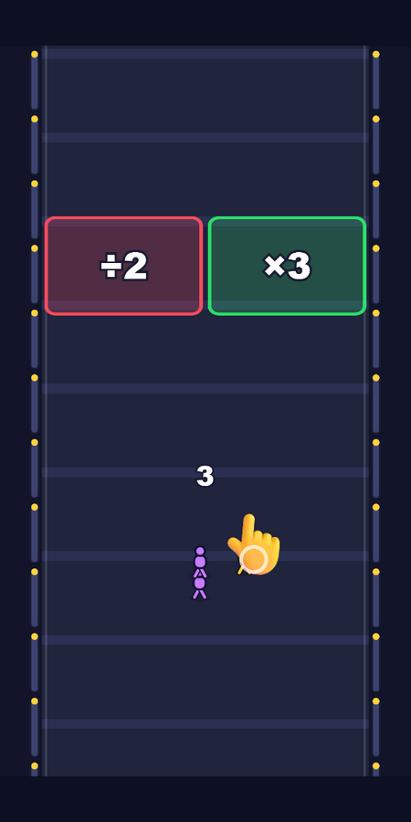
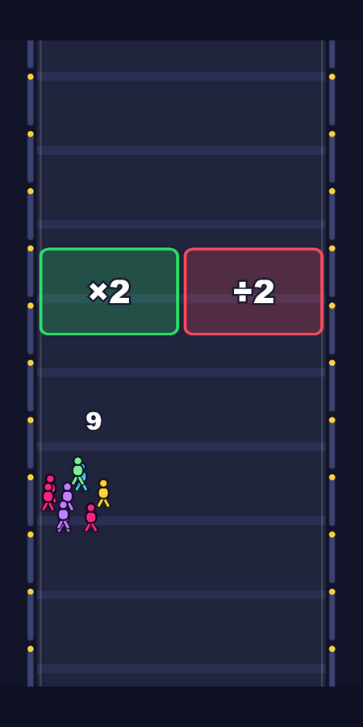
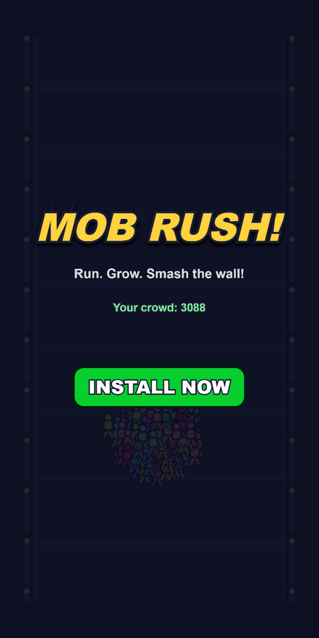

# MOB RUSH! — playable ad

Играбельная реклама (playable ad) жанра **crowd runner**: ведёшь пальцем растущую толпу
через ворота-множители и ловушки, а в конце пробиваешь стену-босса. Вся игра —
**один HTML-файл 472 КБ** без единой внешней зависимости, картинки или аудиофайла.

| Туториал | Геймплей | Финал |
|---|---|---|
|  |  |  |

▶ **Играть:** [живая демка на GitHub Pages](https://kerarty.github.io/playable-ad-mob-rush/)
(или открыть `dist/playable.html` двойным кликом — работает оффлайн).

## Геймплей

- Толпа бежит вперёд, игрок ведёт её влево-вправо свайпом.
- Ворота: `×2`, `+30` — растят толпу; `÷2`, `−40` — уменьшают. Выбор за секунду.
- Лопасти и шипы срезают тех, кто не увернулся.
- В конце — стена-босс с числом: толпы больше → краш-вин, меньше → мгновенный рестарт.
- Уровень детерминированный (seeded RNG): каждый показ рекламы одинаковый.
- Победа достигается за 25–35 секунд, сессия заканчивается end card с кнопкой INSTALL NOW.

## Почему это соответствует требованиям рекламных сетей

| Требование сетей (Meta, AppLovin, Google) | Как выполнено |
|---|---|
| Вес до 2 МБ | **472 КБ** (движок + весь арт + весь звук) |
| Один файл, без внешних запросов | PixiJS, стили и код инлайнятся на сборке |
| Оффлайн после загрузки | нет ни одного сетевого вызова в рантайме |
| MRAID | `viewableChange` → пауза игры и звука, CTA через `mraid.open()`, fallback для браузера |
| Понятность без звука и текста | туториал-рука, управление осваивается за 3 секунды |
| События воронки | `trackEvent()`: `tutorial_start/complete`, `run_failed`, `level_complete`, `cta_click` |
| Производительность | 60 FPS, пулы объектов (частицы, агенты, попапы), коллизии через бакеты по Y |

## Как это собрано

- **Рендер:** PixiJS 7 (WebGL, с fallback на canvas 2d для webview без WebGL).
- **Весь арт — код:** человечки, лопасти, ворота, босс и даже рука туториала рисуются
  на canvas при загрузке и складываются в текстуры. Ни одного png.
- **Весь звук — WebAudio:** рекрут, ворота, удары, фанфара и фоновый луп синтезируются
  осцилляторами и шумом. Ни одного mp3.
- **Толпа:** агенты на пружине держатся за лидера и отталкиваются друг от друга
  (разделение через пространственную сетку). Число толпы и число отрисованных
  агентов разделены: 3088 в счётчике — 240 спрайтов на экране.
- **Сборка:** `esbuild` бандлит `src/` и вставляет вместе с pixi.min.js в HTML-шаблон.

```
src/
  main.js            — вход: слои, ввод, машина состояний, главный цикл
  config.js          — весь баланс в одном месте
  state.js           — FSM (boot→tutorial→run→win/lose→endcard) + seeded RNG
  render/sprites.js  — процедурный арт: все текстуры рисуются кодом
  systems/
    crowd.js         — толпа: пружина к лидеру, разделение, пул спрайтов
    track.js         — скролл дороги и генерация уровня по сиду (+автобаланс босса)
    obstacles.js     — ворота, шипы, лопасти, стена-босса
    particles.js     — пул частиц: конфетти, взрывы
    popupText.js     — всплывающие «+30 / −50»
    camera.js        — тряска экрана и hit-stop
    audio.js         — синтез звука и фоновый луп
    ads.js           — MRAID-обвязка + интерфейс аналитики
  ui/                — рука туториала, end card с CTA
build.mjs            — dev-сборка и упаковка в один файл
dist/playable.html   — готовый артефакт
```

Приятная деталь: hp босса не захардкожено — генератор уровня прогоняет симуляцию
«идеального прохода» и ставит hp = 45% от него. Уровень всегда проходим,
но требует играть хорошо.

## Запуск

```bash
npm install
npm run dev     # соберёт bundle.js — дальше открыть index.html в браузере
npm run build   # соберёт dist/playable.html и копию в docs/index.html
```

Отладка: открыть `dist/playable.html#debug&#fps` — в консоли будет доступен
хук `__mob` (системы игры) и FPS-оверлей.

## Планы

- Запись GIF-геймплея в README.
- Второй креатив с «fake fail»-механикой (намеренно неудачный первый выбор).
